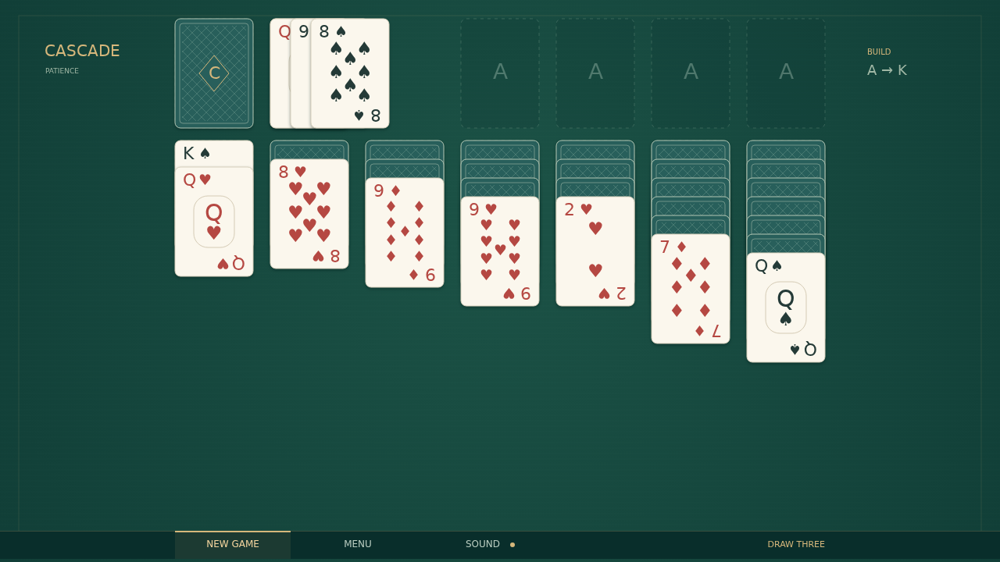

Cascade is Draw Three Klondike on a quiet green table. Turn the stock, uncover the buried cards, and bring a scattered deck into order, one thoughtful move at a time.

Build columns downward in alternating colors. Move a whole face-up run when it opens a useful space, save empty columns for Kings, and send each suit to its foundation from Ace to King. The stock reveals three cards at a time, with the front card ready to play; recycle it whenever you need another pass.

Drag with a mouse or a fingertip, or double-click an exposed card to send it home. There is no clock to race and no score to chase. Start fresh whenever you like, and let the next deal take its own shape.

Finish all four foundations and the order breaks into celebration: fifty-two cards leap from their piles, arc across the felt, bounce along the floor, and leave overlapping trails until the table is buried in cards. Tap anywhere for another beginning.

